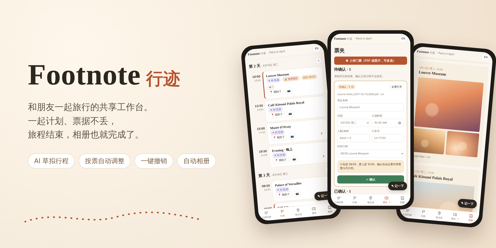
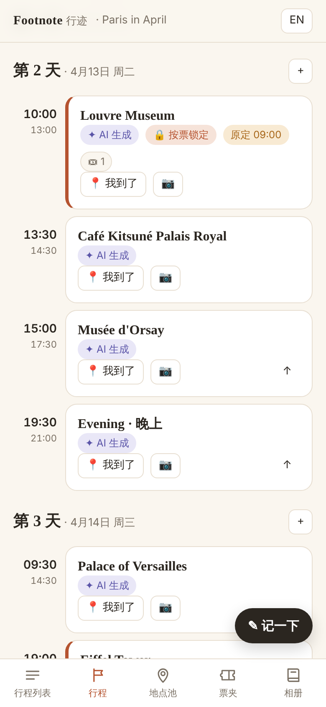
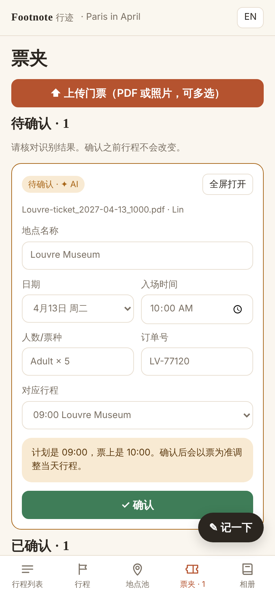
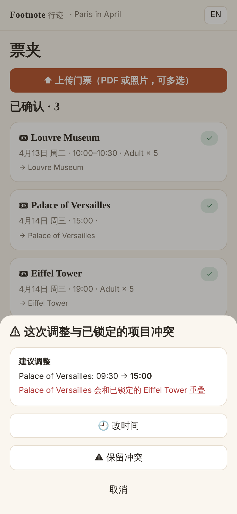
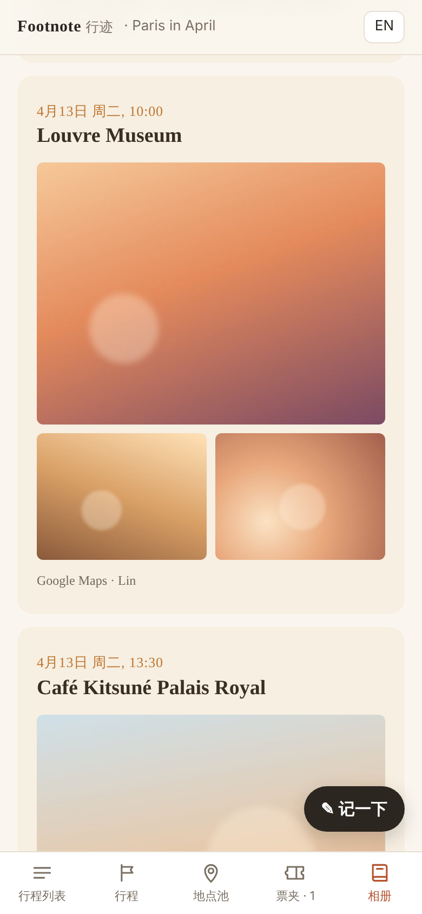
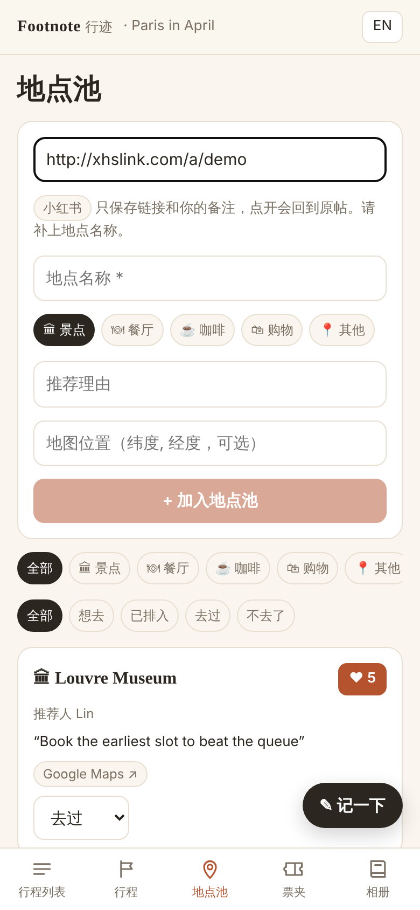
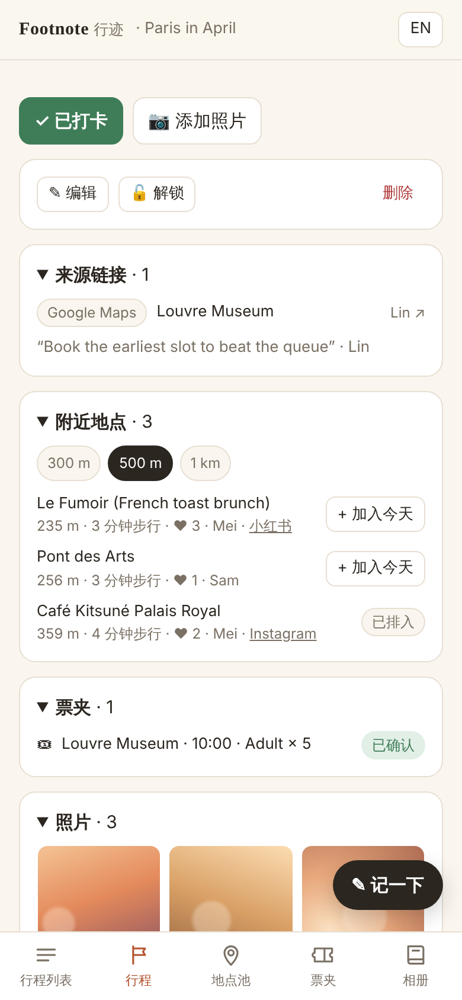
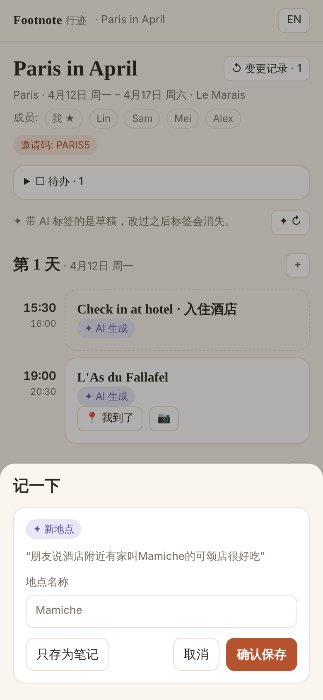
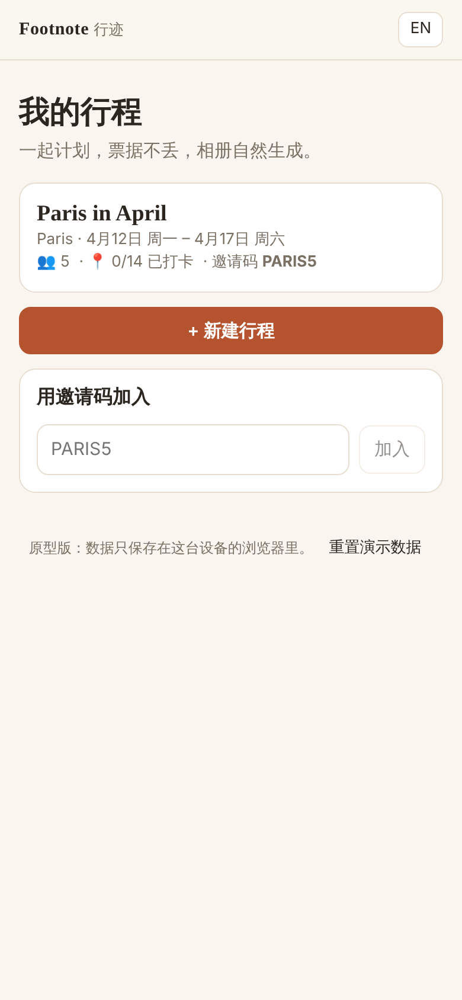

<div align="center">



# Footnote · 行迹

**和朋友一起旅行的共享工作台。一起计划、票据不丢，旅程结束，相册也就完成了。**

[](https://github.com/XuxuZhou02/Your-own-travel-webiste/actions/workflows/ci.yml)


**中文** · [English](README.en.md) · [产品方案](docs/product-plan.md)

</div>

---

> “行迹”是你走过留下的痕迹，也是年底足迹地图上连起来的那条线。
> Footnote 是 *foot* + *note*：走过的路，和路上随手记下的每一句话。

## ✨ 它解决什么

| 痛点 | Footnote 怎么做 |
| --- | --- |
| 小红书、Instagram 上看到的推荐散落在各处，到了地方就忘了 | **地点池**：粘贴链接就收进小组共享池，保留来源，一点回到原帖 |
| 门票和二维码埋在邮件和相册里，到了门口翻半天 | **票夹**：所有票放一起，全屏打开、保持亮屏，没网也能用 |
| 票上的入场时间和计划不一样，后面全得手动重排 | **按票调整**：以票为准自动重排当天行程，有冲突就问你，每一步都能撤销 |
| 拍了很多照片，回来没人整理 | **自动相册**：边走边打卡，行程走完，相册就排好了 |

## 📱 界面一览

<table>
  <tr>
    <td align="center" width="25%"><br><b>行程时间线</b><br><sub>按票锁定，标出原定时间</sub></td>
    <td align="center" width="25%"><br><b>票夹</b><br><sub>确认之前行程不会变</sub></td>
    <td align="center" width="25%"><br><b>冲突提示</b><br><sub>改时间、挪到别的天或保留</sub></td>
    <td align="center" width="25%"><br><b>自动相册</b><br><sub>风格由你选，AI 只推荐</sub></td>
  </tr>
  <tr>
    <td align="center"><br><b>地点池</b><br><sub>小红书等链接一键收藏</sub></td>
    <td align="center"><br><b>附近推荐</b><br><sub>500 米内小组收藏的地点</sub></td>
    <td align="center"><br><b>记一下</b><br><sub>一句话，AI 帮你归档</sub></td>
    <td align="center"><br><b>我的行程</b><br><sub>邀请码加入</sub></td>
  </tr>
</table>

## 🧭 功能

- **AI 行程草稿**：填目的地、日期、到达和离开时间、节奏（每天 2/3/4 项）和必去清单，生成逐日草稿。必去的放在前几天，彼此相近的排在同一天。
- **地点池**：支持小红书、Instagram、TikTok、YouTube、Google Maps 和任意网页链接。点赞、状态（想去 / 已排入 / 去过 / 不去了），同一地点的多个来源自动合并。
- **附近推荐**：打开一个地点，列出 300 米 / 500 米 / 1 公里内小组收藏过的地方，附步行时间，“加入今天”一键排入空档。
- **票夹**：一次上传多张 PDF 或照片，识别结果先显示“待确认”，按名称和日期匹配到行程项目。
- **按票调整行程**：有票的项目是固定锚点，前后的项目只在必要时推后或提前，保持顺序和时长；碰到另一个固定项目就提示冲突，绝不悄悄处理。
- **打卡和照片**：每个项目都有“我到了”和相机按钮，照片压缩一份供浏览，原图默认保留。
- **自动相册**：封面、每天一章、每个地点一页、旅程数据，三种风格可选，可打印或存为 PDF。
- **记一下**：打字或说一句话，自动分成笔记、待办、提醒、新地点、行程调整或提问。新地点和行程调整先预览、你点确认才保存；提问只根据这次行程里的数据回答。
- **中英双语界面**，手机优先，可以添加到主屏幕。

## 🤖 AI 起草，人来确认

1. **AI 只提议**：时间和票相关的改动，必须经过人或固定规则确认才生效。
2. **AI 生成的内容都有标签**，用户改过之后标签消失。
3. **每一步都能不用 AI 手动完成**，AI 出错或没网时产品照样能用。

行程调整的规则代码（`src/lib/schedule.ts`）独立于 AI，有单元测试；以后接入模型时，模型的提议也必须先通过这些规则校验。

## 🚀 快速开始

需要 Node 20 或更高版本。

```bash
npm install
```

```bash
npm run dev
```

打开 http://localhost:3000 。首次打开会载入演示行程 **“Paris in April”**（邀请码 `PARIS5`）：去“票夹”确认卢浮宫的票，就能看到行程按票自动调整。手机上访问电脑的局域网 IP 即可。

| 命令 | 作用 |
| --- | --- |
| `npm test` | 运行单元测试（行程规则、草稿生成、笔记分类、状态操作） |
| `npm run typecheck` | TypeScript 类型检查 |
| `npm run build && npm start` | 生产构建，启用离线缓存（Service Worker） |

> **原型说明**：目前数据只保存在当前浏览器（行程在 localStorage，票和照片在 IndexedDB），还不能多台手机同步。首页底部的“重置演示数据”可以重新开始。

## 🗂️ 项目结构

```text
docs/
  product-plan.md        产品方案
  images/                README 用的截图
src/
  lib/                   业务逻辑，不依赖 React，可单独测试
    schedule.ts          按票调整与规则校验
    skeleton.ts          行程草稿生成
    state.ts             所有状态操作，带变更记录和撤销
    ai/                  统一的 AI 接口 + 离线规则实现
    types.ts             数据模型
    geo.ts · links.ts · time.ts · i18n.ts · files.ts · seed.ts
  app/                   Next.js 页面（底部五个标签）
  components/            共用组件
supabase/schema.sql      多人版数据库结构，按行程成员做行级权限
public/                  PWA 清单、图标、Service Worker
```

## 🛣️ 路线图

- [x] 第一阶段原型：AI 草稿、地点池、票夹、按票调整、打卡照片、自动相册、记一下（文字和语音）
- [ ] 接入 Supabase：登录、多人实时同步、私有文件存储（`supabase/schema.sql` 已写好，尚未在数据库上运行）
- [ ] 接入真实模型：多模态读票、小模型分类笔记，每个行程每日调用上限
- [ ] 接入地图服务：地点搜索和坐标
- [ ] 第二阶段：每日简报、记账和分摊、转发邮件收票、只读成员
- [ ] 第三阶段：记忆空间、年度足迹地图、旅行歌单

详见[产品方案](docs/product-plan.md)第 9 节。

## 🧱 技术栈

[Next.js 16](https://nextjs.org) · React 19 · TypeScript · Vitest · PWA（Service Worker + IndexedDB）· 计划使用 [Supabase](https://supabase.com)
