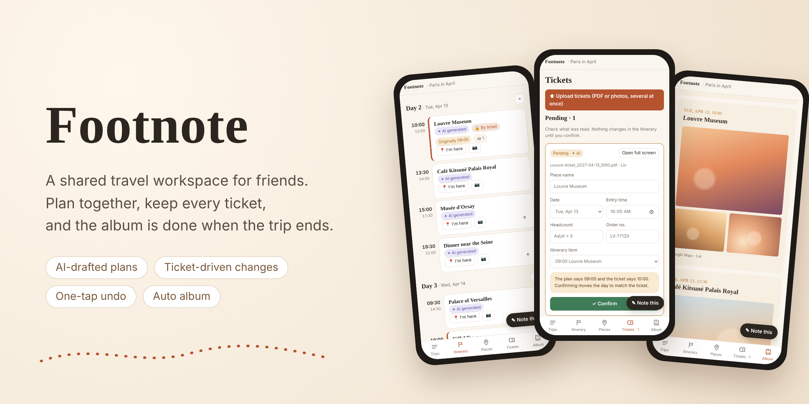
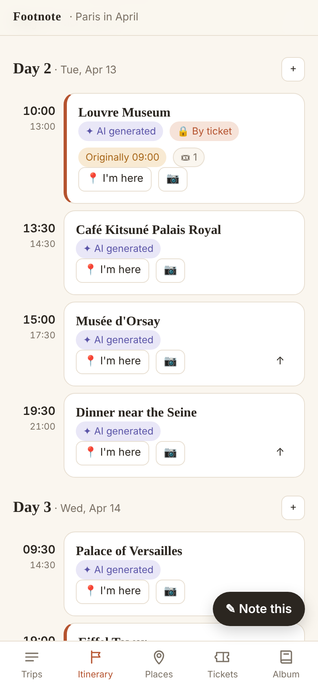
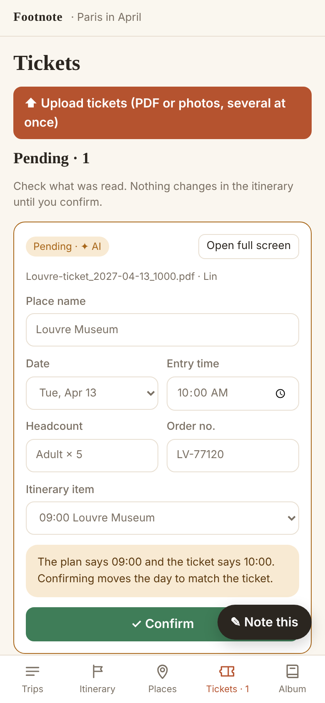
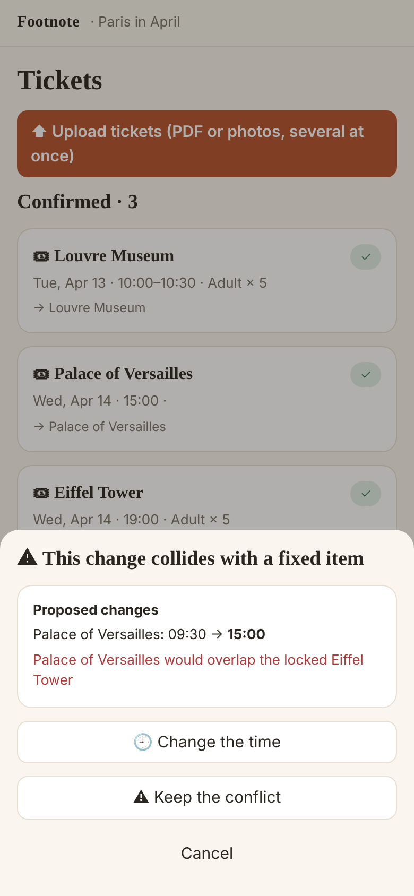
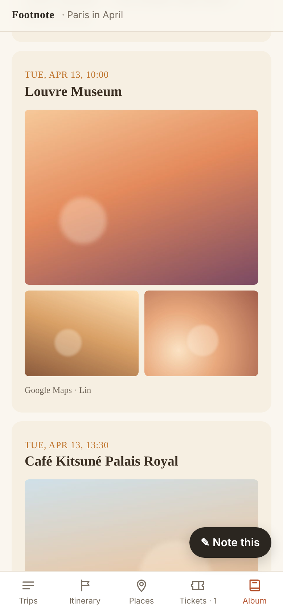
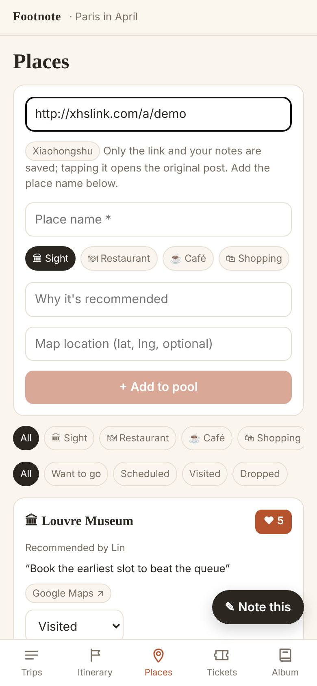
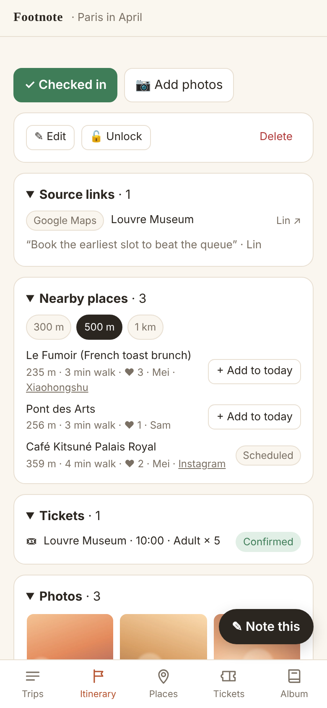
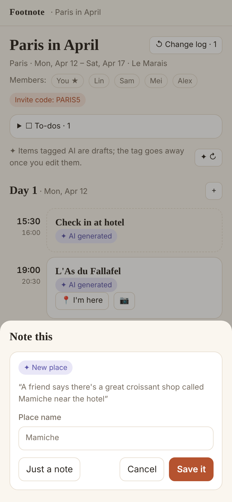
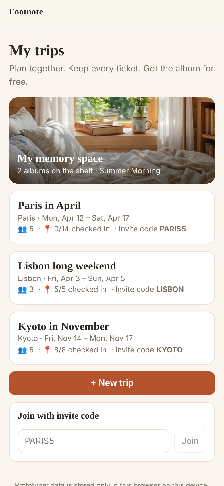
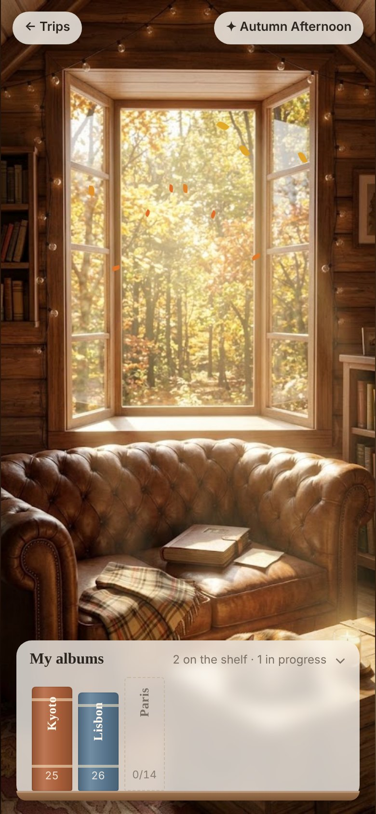

<div align="center">



# Footnote

**A shared travel workspace for friends. Plan together, keep every ticket, and the album is done when the trip ends.**

[](https://github.com/XuxuZhou02/Your-own-travel-webiste/actions/workflows/ci.yml)


[Screens](#-screens) · [Features](#-features) · [Getting started](#-getting-started) · [Roadmap](#-roadmap) · [Product plan](docs/product-plan.md)

</div>

---

> Footnote is *foot* + *note*: the path you walked, and every sentence you jotted down on the way.
> Before the trip it's the itinerary, during the trip it's the ticket wallet, and afterwards it becomes the photo album.

## ✨ What it solves

| Problem | What Footnote does |
| --- | --- |
| Recommendations from Instagram, Xiaohongshu and friends are scattered and forgotten by the time you arrive | **Place pool**: paste a link into the group's shared pool; the source is kept, one tap back to the post |
| Tickets and QR codes are buried in email and the camera roll | **Ticket wallet**: every ticket in one place, full screen, screen kept on, works offline |
| The ticket's entry time doesn't match the plan, so everything after it needs reshuffling | **Ticket-driven changes**: the day rearranges around the ticket, conflicts are asked about, and every step can be undone |
| Lots of photos, nobody organizes them | **Automatic album**: check in as you go, and the album is laid out when the trip is done |

## 📱 Screens

<table>
  <tr>
    <td align="center" width="25%"><br><b>Itinerary</b><br><sub>Locked by ticket, original time shown</sub></td>
    <td align="center" width="25%"><br><b>Tickets</b><br><sub>Nothing changes until you confirm</sub></td>
    <td align="center" width="25%"><br><b>Conflicts</b><br><sub>Change time, move day, or keep</sub></td>
    <td align="center" width="25%"><br><b>Album</b><br><sub>You pick the style; AI only suggests</sub></td>
  </tr>
  <tr>
    <td align="center"><br><b>Place pool</b><br><sub>Save links from any app</sub></td>
    <td align="center"><br><b>Nearby</b><br><sub>Group picks within 500 m</sub></td>
    <td align="center"><br><b>Note this</b><br><sub>One sentence, filed for you</sub></td>
    <td align="center"><br><b>My trips</b><br><sub>Join with an invite code</sub></td>
  </tr>
</table>

## 🧭 Features

- **AI itinerary draft**: destination, dates, arrival and departure times, pace (2, 3 or 4 items a day) and must-sees become a day-by-day draft. Must-sees go on early days, and nearby ones share a day.
- **Place pool**: links from Instagram, TikTok, YouTube, Google Maps, Xiaohongshu or any page. Likes, statuses (want to go / scheduled / visited / dropped), and several sources for one place merge into one card.
- **Nearby suggestions**: open a place to see the group's saved places within 300 m / 500 m / 1 km with walking time; "Add to today" drops one into a free slot.
- **Ticket wallet**: upload several PDFs or photos at once; readings stay "pending" until confirmed and are matched to itinerary items by name and date.
- **Ticket-driven changes**: a ticketed item becomes a fixed anchor. Items around it move only as far as needed, keeping their order and length. A collision with another fixed item becomes a prompt, never a silent fix.
- **Check-ins and photos**: "I'm here" and a camera on every item. A compressed copy is used for browsing; originals are kept.
- **Automatic album**: cover, a chapter per day, a page per place, trip stats; three themes; print or save as PDF.
- **Note this**: type or say one sentence and it becomes a note, to-do, reminder, new place, itinerary change or question. New places and itinerary changes show a preview first. Questions are answered only from this trip's data.
- **Memory space**: a cozy scene of your choice with every finished album on the shelf.
- **Mobile first** and installable to the home screen.

## 🤖 AI drafts, people confirm

1. **AI only proposes.** Time and ticket changes take effect only after a person or a fixed rule approves them.
2. **Everything AI generates is labeled**, and the label disappears once someone edits it.
3. **Every step works without AI**, so the app still works when AI is wrong or there is no network.

The rescheduling rules (`src/lib/schedule.ts`) are plain, tested code, separate from AI. When a model is connected, its proposals must pass these rules first.

## 🚀 Getting started

Requires Node 20 or newer.

```bash
npm install
```

```bash
npm run dev
```

Open http://localhost:3000. A demo trip, **"Paris in April"** (invite code `PARIS5`), loads on first open. Confirm the Louvre ticket under **Tickets** to watch the day rearrange itself. On a phone, use your computer's local IP.

| Command | What it does |
| --- | --- |
| `npm test` | Unit tests (rescheduling rules, draft generation, note sorting, state operations) |
| `npm run typecheck` | TypeScript type check |
| `npm run build && npm start` | Production build with the offline cache (service worker) |

> **Prototype note:** data is stored only in this browser for now (trips in localStorage, tickets and photos in IndexedDB), so it doesn't sync between phones yet. "Reset demo data" at the bottom of the home screen starts over.

## 🗂️ Project layout

```text
docs/
  product-plan.md        the product plan
  images/                screenshots for this README
src/
  lib/                   domain logic, no React, tested on its own
    schedule.ts          ticket-driven rescheduling and validation rules
    skeleton.ts          itinerary draft generator
    state.ts             every state operation, with change log and undo
    ai/                  the single AI interface + offline rule-based provider
    types.ts             data model
    geo.ts · links.ts · time.ts · i18n.ts · files.ts · seed.ts
  app/                   Next.js pages (five bottom tabs, plus /space)
  components/            shared UI
supabase/schema.sql      multi-user database schema with row-level security by trip membership
public/                  PWA manifest, icon, service worker, scene images
```

## 🛋 Memory space

Your own cozy room to come back to, with every finished trip album standing on the shelf. Pick from five scenes, from a summer morning to a snowy night, each with its own light motion (sunlight, falling leaves, a storm, snow, stars). Open it from **My memory space** on the home screen. Details and prompts for making more scenes are in [`docs/scenes`](docs/scenes).

<p>
  
  
  
  
  
</p>

## 🗺 Roadmap

- [x] Phase 1 prototype: AI draft, place pool, ticket wallet, ticket-driven changes, check-in photos, automatic album, Note this (text and voice)
- [x] Memory space: five scenes with light motion and an album shelf
- [ ] Supabase: sign-in, multi-user realtime sync, private file storage (`supabase/schema.sql` is written but hasn't been run against a database)
- [ ] Real models: multimodal ticket reading, a small model for sorting notes, a daily call limit per trip
- [ ] Maps service: place search and coordinates
- [ ] Phase 2: daily brief, expense log and splitting, forward-to-email tickets, viewer role
- [ ] Phase 3: year-end footprint map, trip soundtrack, souvenirs appearing in the memory space

See section 9 of the [product plan](docs/product-plan.md).

## 🧱 Built with

[Next.js 16](https://nextjs.org) · React 19 · TypeScript · Vitest · PWA (service worker + IndexedDB) · [Supabase](https://supabase.com) planned
