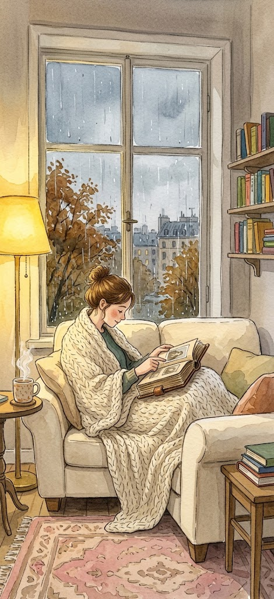
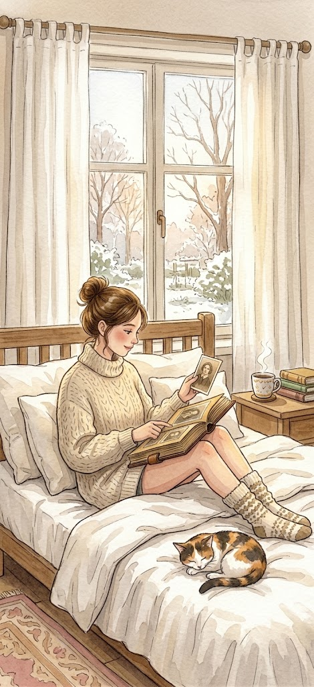
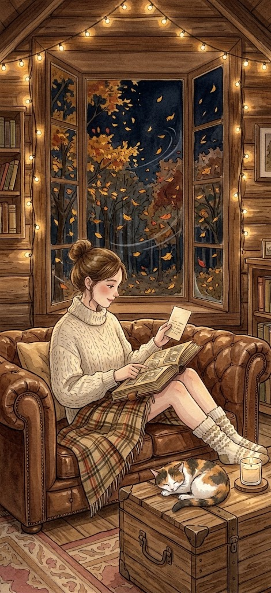

# Memory space scenes

The memory space (product plan, section 4.9) is each user's own cozy scene to come back to, with their finished trip albums standing on a shelf in front of it. It lives at `/space` in the app; pick a scene with the button at the top right.

| | | | | |
| :---: | :---: | :---: | :---: | :---: |
|  |  |  |  |  |
| **Rainy Afternoon** | **Winter by the Fireplace** | **Slow Sunday Morning** | **Autumn Cabin Evening** | **Midnight Nostalgia** |

## In the app

- **The scene** fills the screen (a centered phone-shaped stage on desktop, with a blurred copy behind it).
- **The shelf** at the bottom holds one spine per trip, colored by the album's theme. Finished albums are solid; trips still in progress are dashed outlines with their check-in count. Tap a spine to open the album.
- **Light motion** plays over each picture, lined up with its window, lamp or fire. It turns off when the device asks for reduced motion.

| Scene | Motion |
| --- | --- |
| Rainy Afternoon | Rain streaks on the window, the floor lamp's glow breathing |
| Winter by the Fireplace | Snow falling outside, firelight flickering, lamp glow |
| Slow Sunday Morning | A slow sunbeam and dust motes in the light |
| Autumn Cabin Evening | Leaves blowing past the window, candle flicker, string-light glow |
| Midnight Nostalgia | Stars twinkling in the window, the bedside lamp's glow |

Scene images are in `public/scenes/` (470×1024). The positions of the effects are set per scene in `src/lib/scenes.ts`; adding a scene means adding an image and an entry there.

## Prompts for AI image tools

Use these prompts to make more scenes in the same spirit (Midjourney, DALL·E, Ideogram or similar). Each prompt ends with the same style line so the results match; the watercolor line below matches the current set.

**Shared style line (watercolor, matches the current set):**
`cozy watercolor and ink illustration, soft warm palette, gentle lighting, storybook feel, no text, tall 9:19.5 phone composition`

**Alternative style line (photographic):**
`cinematic photograph, 35mm film, shallow depth of field, soft natural light, warm color grade, no text, tall 9:19.5 phone composition`

1. **Rainy Afternoon**
   > A young woman curled up on a soft cream sofa by a large window on a drizzly autumn afternoon, a thick chunky-knit blanket over her legs, slowly turning the pages of a thick old photo album on her lap, smiling faintly as her fingertip traces the edge of a photo. Raindrops run down the glass, only a warm yellow floor lamp is on, a steaming cup of milk tea on the side table. Mood: rain sounds, cream tones, knit blanket, warm lamp, nostalgia. + style line

2. **Winter by the Fireplace**
   > Heavy snow falling outside a dark window at night, a warm room with a glowing brick fireplace. A young woman in an oversized wool sweater and fluffy socks sits on a thick rug, leaning back against a soft sofa, an old photo album open on her knees; she holds one photo up to the firelight. A mug of hot cocoa and freshly baked cookies beside her, firelight flickering on the pages, wooden furniture. Mood: fireplace, snowy night, warmth. + style line

3. **Slow Sunday Morning**
   > A lazy Sunday morning with no alarm, soft sunlight streaming through white linen curtains onto a messy but cozy bed. A young woman in loose cotton pajamas sits among fluffy pillows, hugging a photo album full of memories and slowly turning faded photos. A cat curled up asleep at the edge of the bed, half a cup of warm coffee on the nightstand, the whole world slowed down. Mood: morning light, white bedding, lazy, cat, softness. + style line

4. **Autumn Cabin Evening**
   > A late-autumn evening inside a warm log cabin in the forest. Golden leaves blowing past the window, soft string lights and wooden furniture inside. A young woman sits cross-legged on a dark brown leather sofa with a plaid blanket around her shoulders, a vanilla-scented candle burning on the wooden coffee table. She lifts an old photo album from the table and pulls out a photo to read the handwritten date on the back. Mood: forest cabin, autumn leaves, scented candle, vintage, peaceful. + style line

5. **Midnight Nostalgia**
   > Late at night, a bedroom lit only by a small amber bedside lamp. A young woman in soft long-sleeved pajamas sits on a bed with cream-white sheets, leaning against big fluffy pillows, a thick photo album on her lap, pausing on an old photo as she remembers. A glass of warm milk on the nightstand, a record player softly playing jazz in the corner, moon and stars through the window. Mood: amber light, midnight, warm milk, jazz, intimate. + style line

**Tips**
- Add `--ar 9:19` in Midjourney, or ask for a tall phone-sized image (at least 1170×2532 for sharp results on modern phones).
- To match the current set, pass one of the images below as a style reference (`--sref <image url>` in Midjourney).
- Keep the bottom quarter calm (rug, floor, blanket): the album shelf sits over it in the app.
