# Memory space scenes

Concept art for the **memory space** (product plan, section 4.9): a cozy scene each user picks as their own place to come back to, where their trip albums wait on the shelf. Five candidates, drawn in one style and palette so any of them sits naturally next to the app.

Each scene is an animated SVG (open it in a browser to see the rain, snow, fire, steam, falling leaves and twinkling lights) with a still JPG next to it.

| | |
| --- | --- |
|  **1. Rainy Afternoon** Rain on the glass, a cream sofa, a knit blanket, a warm floor lamp, milk tea |  **2. Winter by the Fireplace** Snow outside, a crackling fire, a thick rug, hot cocoa and cookies |
|  **3. Slow Sunday Morning** Sun through linen curtains, white bedding, a sleeping cat, coffee |  **4. Autumn Cabin Evening** A log cabin, golden leaves falling, string lights, a plaid shawl, a vanilla candle |
|  **5. Midnight Nostalgia** An amber bedside lamp, warm milk, a spinning record, moon and stars | |

## What moves

| Scene | Animation |
| --- | --- |
| Rainy Afternoon | Rain streaks, drops sliding down the glass, steam from the tea, lamp glow breathing |
| Winter by the Fireplace | Snowfall, flickering flames and candles, firelight pulsing on the room, cocoa steam |
| Slow Sunday Morning | Curtain swaying, sunbeam brightening and fading, the cat breathing, coffee steam |
| Autumn Cabin Evening | Leaves falling past the window, string lights twinkling, candle flame |
| Midnight Nostalgia | Stars twinkling, the record spinning, music notes drifting up, lamp glow |

## Prompts for AI image tools

These illustrations are hand-drawn vector art. For richer, painterly versions, use the prompts below in Midjourney, DALL·E, Ideogram or similar. Each prompt ends with the same style line so the five results match. Swap it for the photographic line to get realistic photos instead.

**Shared style line (illustrated):**
`cozy flat illustration, soft grain texture, warm muted palette, gentle lighting, no text, wide 3:2 composition`

**Alternative style line (photographic):**
`cinematic photograph, 35mm film, shallow depth of field, soft natural light, warm color grade, no text, 3:2`

1. **Rainy Afternoon**
   > A young woman curled up on a soft cream sofa by a large window on a drizzly autumn afternoon, a thick chunky-knit blanket over her legs, slowly turning the pages of a thick old photo album on her lap, smiling faintly as her fingertip traces the edge of a photo. Raindrops run down the glass, only a warm yellow floor lamp is on, a steaming cup of milk tea on the side table. Mood: rain sounds, cream tones, knit blanket, warm lamp, nostalgia. + style line

2. **Winter by the Fireplace**
   > Heavy snow falling outside a dark window at night, a warm room with a glowing brick fireplace. A young woman in an oversized wool sweater and fluffy socks sits on a thick rug, leaning back against a soft sofa, an old photo album open on her knees; she holds one photo up to the firelight. A mug of hot cocoa and freshly baked cookies beside her, firelight flickering on the pages, wooden furniture. Mood: fireplace, snowy night, warmth. + style line

3. **Slow Sunday Morning**
   > A lazy Sunday morning with no alarm, soft sunlight streaming through white linen curtains onto a messy but cozy bed. A young woman in loose cotton pajamas sits among fluffy pillows, hugging a photo album full of memories and slowly turning faded photos. A cat curled up asleep at the edge of the bed, half a cup of warm coffee on the nightstand, the whole world slowed down. Mood: morning light, white bedding, lazy, cat, softness. + style line

4. **Autumn Cabin Evening**
   > A late-autumn evening inside a warm log cabin in the forest. Golden leaves blowing past the window, soft string lights and wooden furniture inside. A young woman sits cross-legged on a dark brown leather sofa with a plaid blanket around her shoulders, a vanilla-scented candle burning on the wooden coffee table. She lifts an old photo album from the table and pulls out a photo to read the handwritten date on the back. Mood: forest cabin, autumn leaves, scented candle, vintage, peaceful. + style line

5. **Midnight Nostalgia**
   > Late at night, a bedroom lit only by a small amber bedside lamp. A young woman in soft long-sleeved pajamas sits on a bed with cream-white sheets, leaning against big fluffy pillows, a thick photo album on her lap, pausing on an old photo as she remembers. A glass of warm milk on the nightstand, a record player softly playing jazz in the corner, moon and stars through the window. Mood: amber light, midnight, warm milk, jazz, intimate. + style line

**Tips**
- Add `--ar 3:2` in Midjourney, or ask for a 1536×1024 image elsewhere.
- For a set that looks like one family, generate scene 1 first, then pass it as a style reference (`--sref <image url>` in Midjourney) for the other four.
- For the app, leave some empty wall or shelf space in each scene, which is where the album rack will go.
