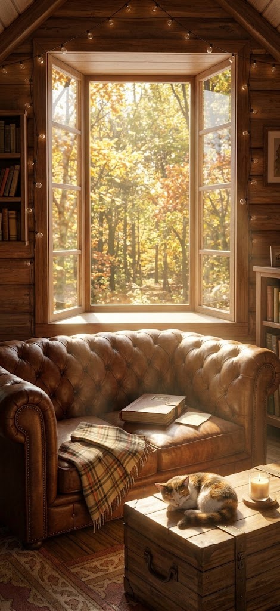

# Memory space scenes

The memory space (product plan, section 4.9) is each user's own cozy room to come back to, with their finished trip albums standing on a shelf in front of it. It lives at `/space` in the app; pick a scene with the button at the top right.

| | | | | |
| :---: | :---: | :---: | :---: | :---: |
|  |  |  |  |  |
| **Summer Morning** | **Autumn Afternoon** | **Stormy Evening** | **Winter by the Fireplace** | **Midnight Nostalgia** |

The five run from morning to midnight and through the seasons, all in the same wooden cabin, so switching scenes feels like moving around one home.

## In the app

- **The scene** fills the screen (a centered phone-shaped stage on desktop, with a blurred copy behind it).
- **The shelf** at the bottom holds one spine per trip, colored by the album's theme. Finished albums are solid; trips still in progress are dashed outlines with their check-in count. Tap a spine to open the album, or tap "My albums" to fold the shelf down and see the whole room.
- **Light motion** plays over each picture, lined up with its window, lamp, candle or fire. It turns off when the device asks for reduced motion.

| Scene | Motion |
| --- | --- |
| Summer Morning | Dust motes drifting in the sunlight, the candle flickering |
| Autumn Afternoon | Leaves blowing past the window, warm light, the candle flickering |
| Stormy Evening | Heavy slanted rain on the window, the occasional flash of lightning, lamp glow |
| Winter by the Fireplace | Snow falling outside, firelight and candlelight flickering, lamp glow |
| Midnight Nostalgia | Stars twinkling in the window, the bedside lamp's glow |

Scene images are in `public/scenes/` (470×1024). The positions of the effects are set per scene in `src/lib/scenes.ts`; adding a scene means adding an image and an entry there.

## Prompts for more scenes

To add scenes that match this set, use the prompts below in Midjourney, DALL·E, Ideogram or similar. Each ends with the same style line so the results belong together.

**Shared style line:**
`photorealistic cozy interior, warm wooden cabin, soft natural light, no people, rich textures, cinematic, no text, tall 9:19.5 phone composition`

1. **Summer Morning**
   > A sunlit attic bedroom in a wooden cabin on a summer morning. Sheer white linen curtains framing a tall open window onto bright green trees and blue sky. An unmade bed with white linen and soft pillows, an open photo album with loose vintage photos spread across the duvet, a knit throw at the foot. Wildflowers in a ceramic jug on the windowsill, a floor lamp, an old wooden trunk with a candle. + style line

2. **Autumn Afternoon**
   > A wooden cabin living room on an autumn afternoon. A wide bay window opened onto a golden forest, sunlight streaming in. A worn brown leather Chesterfield sofa with a plaid blanket and a closed photo album resting on the cushion. A calico cat asleep on a wooden trunk coffee table beside a lit candle. String lights along the beams, bookshelves on both sides. + style line

3. **Stormy Evening**
   > A wooden cabin at dusk during a storm. Rain lashing against a bay window, trees bending in the wind outside. A cream tufted sofa with a chunky knit blanket draped over it, an old book and a mug on the window seat. A glowing floor lamp, string lights along the beams, a candle on a wooden trunk, bookshelves. Safe and warm inside. + style line

4. **Winter by the Fireplace**
   > A wooden cabin on a snowy winter night. Heavy snow falling past a bay window. A stone fireplace with a crackling fire, a garland with red ornaments and candles on the mantel. A chunky knit rug with an old photo album open on it and loose black-and-white photos scattered nearby. Hot cocoa and cookies on the window seat, a tartan blanket on a cream armchair, a glowing floor lamp, string lights. + style line

5. **Midnight Nostalgia**
   > A wooden cabin bedroom late at night. A small amber bedside lamp the only light, a glass of warm milk steaming on the nightstand. A wooden bed with plump pillows and a leopard-print quilt, an old photo album open on the pillows, a calico cat asleep at the foot of the bed. A small window with stars and dark pines, bookshelves in the corner. + style line

**Tips**
- Add `--ar 9:19` in Midjourney, or ask for a tall phone-sized image. At least 1170×2532 keeps it sharp on modern phones.
- To match the current set, pass one of the images above as a style reference (`--sref <image url>` in Midjourney).
- Keep the bottom fifth quiet (floor, rug, the foot of a bed): the album shelf sits over it in the app.
